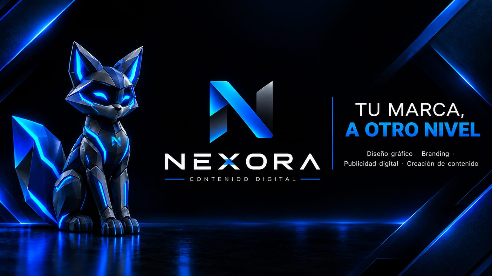

# NEXORA | Agencia de Contenido Digital

> **Innovación y Contenido Digital desde Anserma, Caldas, Colombia.**  
> Landing page profesional, moderna y de estética cinematográfica y futurista (*dark cyber theme*).

---

## ⚡ Identidad y Estética

- **Fondo Principal:** Deep Navy Blue (`#030712`)
- **Acentos y Efectos:** Vibrant Electric Blue Neon (`#00E5FF`)
- **Estilo:** High-Tech, Cyber, Glassmorphism y Microinteracciones
- **Ubicación:** Anserma, Caldas, Colombia
- **Año:** 2026

---

## 🛠️ Servicios Principales

1. **Desarrollo y Maquetación Web**
   - Sitios web corporativos, interfaces interactivas y landing pages de alta conversión.
   - Código limpio, semántico, accesible y 100% responsivo para móviles, tablets y escritorio.

2. **Modelado y Renders 3D en Blender**
   - Visualización fotorrealista de producto, iluminación volumétrica, materiales PBR y cinemáticas en ultra alta definición 4K.

3. **Identidad Visual & Branding con Affinity y Canva**
   - Sistemas integrales de marca, diseño vectorial de logotipos en Affinity Designer & Photo, manuales de identidad y plantillas dinámicas en Canva Pro.

---

## 📱 Contacto Directo

- **WhatsApp Directo:** [+57 323 540 7807](https://wa.me/573235407807)
- **Ubicación:** Anserma, Caldas, Colombia

---

## 🚀 Cómo Visualizar el Proyecto

Simplemente abre el archivo `index.html` en cualquier navegador web moderno (Google Chrome, Microsoft Edge, Mozilla Firefox, Brave, Safari). No requiere instalación de dependencias ni servidores complejos.

---

&copy; 2026 **NEXORA**. Anserma, Caldas. Todos los derechos reservados.
